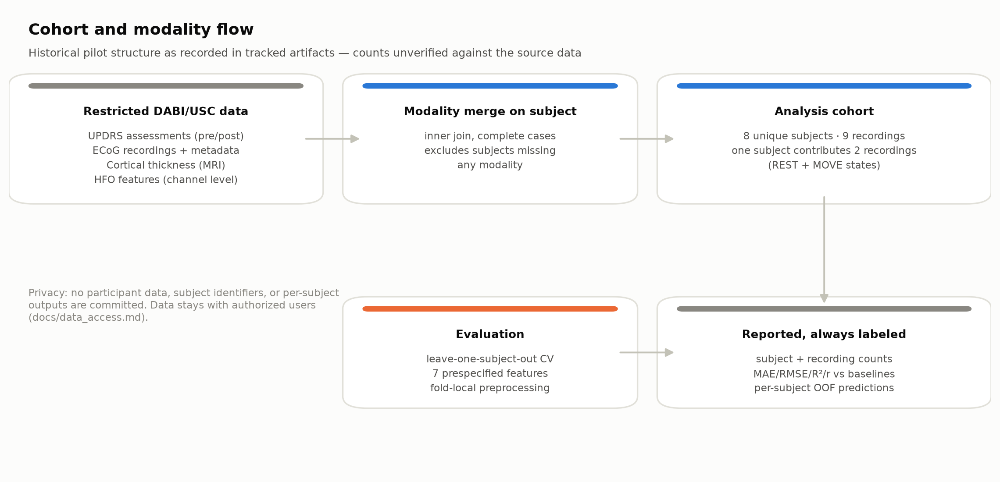
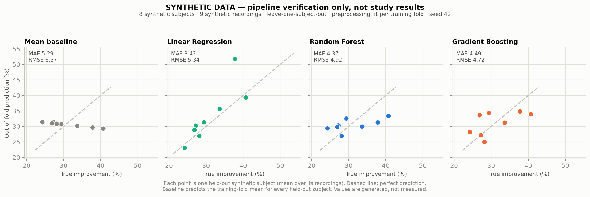

# CURVE-ICON-DBSO

**CURVE** — The Center for Undergraduate Research in Viterbi Engineering ·
**ICON** — Informatics and Computing in Neuroscience Lab, USC ·
**DBSO** — Deep Brain Stimulation Outcome (prediction)

An exploratory, subject-grouped machine-learning analysis asking whether
intraoperative ECoG high-frequency oscillations (HFOs) and clinical measures carry
any signal about Deep Brain Stimulation outcome — on a pilot cohort of **8 subjects
(9 recordings)**.

> ### note: exploratory research prototype — not for clinical use
> Retrospective, single-center research with two small cohorts. No valid **DBS-outcome**
> performance estimate exists: the historical n = 8 result was invalidated by a
> prediction-alignment bug plus data leakage. A separate n = 31 real-data analysis of
> concurrent finger-tapping behavior produced a negative exploratory result; it is
> not a treatment-outcome study. Nothing here supports clinical decision-making,
> counseling, patient selection, or DBS programming.
>
> **Independent personal project.** This repository is not sponsored by,
> conducted for, or represented as affiliated with any former lab or
> institution (the acronyms above are historical naming only), and nothing
> here implies endorsement by them. The owner is solely responsible for
> ensuring that any data and resources used are lawful and appropriate —
> see [docs/approvals.md](docs/approvals.md) for the non-blocking notices.

---

## executive summary

- **Question:** can HFO + clinical features relate to motor improvement (% UPDRS
  change) after DBS, measurable at pilot scale? *(Answer at this sample size: not
  reliably — and that is the honest result.)*
- **Data:** the pilot data (USC DABI) is used **locally under the
  owner's independent authorization from the distributor** — analysis
  and publication of research findings are authorized; the data itself
  is not redistributable and is **not included in this repository**.
  All runnable code paths are also verified on deterministic synthetic
  data ([docs/data_access.md](docs/data_access.md)).
- **Correction story:** the original pipeline reported R² = 0.713 (README) while its
  own figures showed −0.672. Root cause found: fold-order predictions saved against
  original-row-order subjects. This repository contains the corrected evaluation,
  tests that pin it, and the invalid figures archived as documentation.
- **Status:** research prototype; negative/feasibility results are preserved rather
  than optimized away. The scientific correction, follow-on study, inference API,
  CI/security gates, Terraform/ECS deployment, observability, load test, rollback
  exercise, and local Kubernetes comparison are complete. The ephemeral AWS
  environment was **destroyed** after verification (measured evidence in
  [docs/deployment_report.md](docs/deployment_report.md)).

## Technical-recruiter summary

This project demonstrates an end-to-end ML engineering workflow, not a successful
clinical model:

| Area | What was built | Measured evidence |
|---|---|---|
| ML validation | Subject-grouped nested CV, fold-local preprocessing, aligned out-of-fold predictions, naive baselines, cluster bootstrap intervals, and permutation/shift nulls | 31-subject follow-on study; 38,078 causal movement windows; complete corrective test matrix; global null reported honestly |
| Modeling | Linear, tree-based, kernel, Bayesian, Gaussian-process, XGBoost, lagged decoding, DMD, and contrastive-representation components | No subject-level model met the promotion rule; movement decoder r = .063 but MAE .721 lost to persistence (.282) and block mean (.629) |
| Production ML | Versioned feature schema, deterministic synthetic model artifact, hash-verified loading, FastAPI batch inference, Docker, and metadata-only logging | 189.5 MB image; 0.85 s median cold start; order-preserving batches of 1–256 rows |
| Cloud/MLOps | Terraform-managed CloudFront → ALB → ECS Fargate, CI security/privacy gates, SBOM and vulnerability checks, CloudWatch alarms, load/drift/rollback exercises | 34,177 requests, 0 failures, p95 110 ms, zero restarts; rollback in about 70 s with zero dropped requests |
| Engineering quality | Reproducible lock file, Python 3.11/3.12 CI, synthetic end-to-end fixtures, leakage and governance tests | 490 offline tests passed in the definitive local run; live GitHub status is shown by the Actions badge below |

[](https://github.com/oleeveeuh/CURVE-ICON-DBSO/actions/workflows/ci.yml)

### Documentation guide

| Reader goal | Start here |
|---|---|
| Understand the system and engineering decisions | [Architecture](docs/architecture.md) and [decision records](docs/decisions/README.md) |
| Review scientific validity and exact results | [Methodology](docs/methodology.md), [limitations](docs/limitations.md), and [definitive follow-on results](docs/results_followon_real.md#v101-corrective-rerun-2026-11-18--definitive-frozen-contract-verdicts) |
| Run the model service locally | [API and container guide](docs/api.md) |
| Review deployment evidence | [Deployment report](docs/deployment_report.md) and [operations runbook](docs/runbook.md) |
| Audit privacy and data boundaries | [Data-access policy](docs/data_access.md) and [architecture privacy boundary](docs/architecture.md#5-privacy-boundary) |
| Understand historical plans/prompts | [Extension plan](docs/mlops_extension_plan.md) and implementation-prompt files; these are provenance, not current-status summaries |

## Research questions (two, kept strictly separate)

1. **DBS-outcome prediction (paused).** Do resting/task ECoG HFO features recorded
   from sensorimotor cortex, together with routine clinical measures, carry
   measurable association with the *magnitude of motor improvement after DBS* —
   and can any such association survive honest, subject-grouped validation at
   n = 8? This is the historical outcome question; it is **paused** because the
   clinical outcome table was unavailable at analysis time and could not be
   recovered. The corrected pipeline and its 7-feature prespecified schema are
   ready for it, but no outcome result exists or is claimed.
2. **Kinematic neural–motor analysis (active, prespecified).** Do resting-state
   HFO features and basic covariates relate to *concurrent motor performance*
   (finger-tapping rate from a sensor glove) during intraoperative recordings?
   This is an exploratory neural–motor relationship question — explicitly **not**
   DBS-outcome prediction, since glove kinematics measure motor state during the
   session, not treatment response. (See [docs/methodology.md](docs/methodology.md).)

Both questions use subjects (not rows) as evaluation units, fold-local
preprocessing, baselines, aligned out-of-fold predictions, and fixed
hyperparameters. The DBS-outcome question has no valid real-data result. The
kinematic question was run on 31 authorized local recordings and produced a
negative exploratory result; only sanitized aggregate results are published.

## Dataset and cohort

| Item | Value |
|---|---|
| Source | USC DABI (Data Archive for the BRAIN Initiative) — processed locally under the owner's independent distributor authorization; **data not included in this repository** (see [docs/data_access.md](docs/data_access.md)) |
| Modalities | UPDRS assessments (pre/post) · intracranial ECoG + recording metadata · cortical thickness (MRI) · HFO features |
| Historical DBS-outcome cohort | **8 unique subjects, 9 recordings** — one subject contributes 2 recordings (REST + MOVE); remaining subjects contribute 1 |
| Follow-on kinematic cohort | **31 subjects / 31 recordings** for subject-level analyses; 29 recordings yielded usable MOVE windows |
| Counts in results | Every result reports both subject and recording counts |
| Privacy | No participant data, subject identifiers, raw signals, or per-subject outputs are committed; `data/`, `outputs/`, `*.csv`, `*.mat` are gitignored |

The historical 8/9 structure comes from tracked artifacts and is marked unverified
against the source data. The 31-subject follow-on counts are recorded by the
authorized local run; participant-level files remain outside version control.



## Pipeline architecture


System-level diagrams — local research flow, synthetic artifact flow,
CI/CD, the AWS runtime, and the privacy boundary — are maintained in
[docs/architecture.md](docs/architecture.md).

## Implemented feature extraction (complete list)

Per ECoG channel ([`src/curve_icon_dbso/hfo.py`](src/curve_icon_dbso/hfo.py)):

- 4th-order zero-phase Butterworth band-pass (default **80–500 Hz**), validated
  strictly below Nyquist;
- Welch PSD → **band power** and **peak frequency**;
- per-channel **QC status + failure reason** — failures are never zero-filled, and
  there is no random/placeholder fallback anywhere.

Per subject ([`src/curve_icon_dbso/features.py`](src/curve_icon_dbso/features.py)):

- mean of OK channels for the two HFO features;
- UPDRS-derived bradykinesia / rigidity / tremor composites per side and
  **asymmetry indices**; disease duration; age;
- a **prespecified set of 7 features** — fixed a priori, no data-driven selection.

**Not implemented, therefore not claimed:** phase-amplitude coupling, artifact
rejection, SNR, stability metrics, spatial-distribution summaries. (The historical
README's "18 neural biomarkers" and "108 features" were unsupported — artifacts show
32 engineered columns, 2 of them HFO-derived.)

## Validation design (corrected)

1. **Subjects are the evaluation units**: leave-one-subject-out CV — every fold
   holds out *all* recordings of one subject; no recording straddles train/test.
2. **Fold-local preprocessing**: median imputation + standardization inside an
   sklearn `Pipeline`, fit on each training fold only. No feature selection (the 7
   features are prespecified).
3. **Baselines**: `DummyRegressor` mean and median through the identical procedure.
   A model is not called useful unless it beats both.
4. **Aligned out-of-fold predictions**: preallocated array,
   `oof[test_idx] = pipe.predict(X_test)` — regression-tested with nonsequential
   fold indices (`tests/test_alignment.py`).
5. **Metrics**: MAE, RMSE, R², Pearson r + per-subject OOF predictions and errors.
6. **Uncertainty**: subject-cluster bootstrap confidence intervals for MAE/RMSE
   (2,000 resamples, fixed seed) and a subject-level label-permutation null
   (≥ 200 permutations through the complete CV workflow, conservative p-values) —
   descriptive at pilot n, never confirmatory.
7. **No tuning**: hyperparameters are fixed and documented; nothing is optimized
   against held-out subjects.

**Small-sample caveat (applies to everything below):** LOSO on 8 subjects yields
exactly 8 held-out predictions. R² and correlation are highly unstable at this size
(expected R² under the null is *negative*); a single subject can flip any ranking.

## Verified results

**No valid DBS-outcome performance estimate exists.** The historical numbers
(R² 0.713 / 0.845) were products of the misalignment + leakage defects and are
retracted; their figures are archived under
[`figures/archive/`](figures/archive/README.md) as documentation of the defect.

**Follow-on three-arm study (frozen contract v1.0.0 → corrective v1.0.1, 2026-11-18):** a fully negative, exploratory result under the complete frozen matrix — **global null**: no subject-level block × model met the promotion rule (ten-test Holm family minimum adjusted p = 1.0); MOVE methodology transfer **NOT successful** (median r ≈ .06 with CI [.036, .109], but decoder MAE .721 vs persistence .282 and block-mean .629 — criterion failed in code); corrected circular and blockwise shift nulls both p = .002 (small above-null alignment, far below naive temporal references); DMD did not improve correlation over band power. The v1.0.0 run's partial verdicts are superseded by this corrective rerun (identical inputs, manifest-verified); sanitized aggregates: [`docs/results_followon_real.md`](docs/results_followon_real.md).

What *is* verifiable is the machinery, on synthetic data
(`figures/synthetic_oof_verification.png`; regenerate with the quick start below —
seeded, byte-identical across runs):

| Model (LOSO, synthetic cohort) | MAE | RMSE | R² | Pearson r |
|---|---|---|---|---|
| Mean baseline | 5.29 | 6.37 | −0.256 | — |
| Median baseline | 5.37 | 6.33 | −0.242 | — |
| Linear Regression | 3.42 | 5.34 | 0.116 | 0.813 |
| Random Forest | 4.37 | 4.92 | 0.249 | 0.556 |
| Gradient Boosting | 4.49 | 4.72 | 0.310 | 0.561 |

*Synthetic data with a planted linear signal — these numbers demonstrate that the
evaluation is correctly aligned and leakage-controlled; they say nothing about real
DBS outcomes.* All three models beat both baselines here **by construction** (the
generator plants a learnable signal); with 8 real subjects the honest expectation is
a null or uninterpretable result, and the corrected pipeline is designed to show
that rather than hide it.



## Why n = 8 cannot establish clinical utility

- Eight held-out predictions give confidence intervals so wide that no model
  comparison is meaningful; R² can be negative for a genuinely informative model.
- Selection effects from requiring complete multi-modal data are unquantified.
- REST vs MOVE, anesthesia, and medication state confounds are unmodeled.
- Any "top feature" ranking at this n is noise; the pipeline therefore refuses to
  rank features. See [docs/limitations.md](docs/limitations.md).

## Quick start (offline, no data required)

```bash
git clone https://github.com/oleeveeuh/CURVE-ICON-DBSO.git
cd CURVE-ICON-DBSO

# locked environment (uv; reproducible per uv.lock; `.python-version` pins
# Python 3.11 — the same interpreter CI matrix and the Dockerfile use).
# These four extras cover the entire offline test suite plus the demo and
# service (the fifth, `cloud`, is only needed for the Locust load test in
# docs/runbook.md §8c):
uv sync --locked --extra dev --extra api --extra tracking --extra analysis \
  && source .venv/bin/activate
# ...or plain pip, which still works:
# python3.11 -m venv .venv && source .venv/bin/activate && pip install -e ".[dev,api,tracking,analysis]"

# deterministic synthetic end-to-end run (~seconds; adds bootstrap CIs and a
# label-permutation null — raise --permutations to the protocol default of 200
# for evaluation-grade runs)
curve-icon-demo --output-dir outputs/synthetic_demo

# regenerate README figures
python scripts/make_figures.py
```

## Using the authorized dataset (local, non-synthetic)

No third-party data is in this repository. The pilot dataset (USC DABI)
is used **locally** under the owner's independent authorization from
the distributor: analysis and publication of research findings are
authorized; the data itself is not redistributable and stays on the
owner's machine, outside this checkout (details and the register:
[docs/data_access.md](docs/data_access.md); owner-responsibility
notices: [docs/approvals.md](docs/approvals.md)).

Two analysis entry points, both printing a non-blocking data-use
reminder and defaulting outputs outside the repository:

```bash
# outcome-analysis HFO features from per-subject .mat folders:
python scripts/run_hfo_extraction.py \
  --input-dir /local/path/to/all_subs_preprocessed_data \
  --output-csv /local/outputs/hfo_channels.csv \
  --aggregated-csv /local/outputs/hfo_subjects.csv \
  --band-low 80 --band-high 500 --fs-override 1200

# kinematic analysis: per-recording .npz files -> feature table ->
# grouped-CV evaluation (see scripts/build_kinematic_table.py --help
# and scripts/evaluate_real_kinematics.py --help for the contracts)
python scripts/build_kinematic_table.py \
  --input-dir /local/path/to/recordings_npz \
  --output-csv /local/outputs/kinematic_recordings.csv
python scripts/evaluate_real_kinematics.py \
  --features-csv /local/outputs/kinematic_recordings.csv \
  --output-dir /local/outputs/kinematic_results \
  --stage exploratory
```

## Phase 2: synthetic inference service (research demonstration)

A strictly validated FastAPI service serves a **synthetic-trained**
demonstration model — an engineering artifact, not a clinical or
scientific result. Setup, training, endpoint contract, manifest
explanation, Docker instructions, and troubleshooting live in
[docs/api.md](docs/api.md).

```bash
uv sync --locked --extra dev --extra api              # locked environment (idempotent)
python scripts/train_synthetic_model.py               # deterministic synthetic artifact
```

Design points: one versioned 7-feature schema shared by training, the
API, and the manifest (`src/curve_icon_dbso/schema.py`); hash-verified
artifact loading that fails readiness loudly on any mismatch; batches of
1–256 rows with order-preserving predictions; payloads, predictions, and
feature values never logged; non-root single-worker container with a
readiness-gated health check; **no `/explain` endpoint** by recorded
decision ([docs/decisions/ADR-002-explanation-endpoint.md](docs/decisions/ADR-002-explanation-endpoint.md)).
Measured (2026-11-15): container image 189.5 MB, containerized cold
start 0.85 s median, local dev-machine cold start 1.15 s median
([docs/deployment_report.md](docs/deployment_report.md) §2).

A reviewer can verify the service end to end in about a minute once the
artifact is trained. First locally (artifact dir defaults to
`./artifacts/synthetic-demo`), then in the container (built tag `local`,
mapped to host port 8001 so it cannot collide with the local server):

```bash
# 1) local service
uvicorn curve_icon_dbso.api.main:app --workers 1 --no-access-log &
sleep 3
curl -fsS http://127.0.0.1:8000/ready        # 200 once the artifact hash chain verifies
curl -fsS http://127.0.0.1:8000/model-info | python3 -m json.tool   # synthetic-only provenance visible
curl -fsS -X POST -H 'content-type: application/json' \
  --data @tests/fixtures/synthetic_predict_request.json \
  http://127.0.0.1:8000/predict              # schema-valid synthetic batch, 1–8 rows

# 2) container (image retrains the model internally during the build)
docker build --build-arg SOURCE_SHA=$(git rev-parse HEAD) \
    -t curve-icon-dbso-api:local .
docker run --rm -d -p 8001:8000 curve-icon-dbso-api:local
sleep 3
curl -fsS http://127.0.0.1:8001/ready
curl -fsS http://127.0.0.1:8001/model-info | python3 -m json.tool
curl -fsS -X POST -H 'content-type: application/json' \
  --data @tests/fixtures/synthetic_predict_request.json \
  http://127.0.0.1:8001/predict

# 3) stop both
docker stop $(docker ps -q --filter ancestor=curve-icon-dbso-api:local)
kill %1   # the backgrounded uvicorn
```

The full endpoint contract, error classes, manifest walkthrough, and
troubleshooting live in [docs/api.md](docs/api.md).

## Phases 3–5: CI/CD gates and the public synthetic AWS track (deployed, verified, destroyed)

Every pull request runs: locked install, Ruff, the offline suite with
coverage, secret + subject-identifier scanning, a real container build with
SBOM generation and an exceptions-aware HIGH/CRITICAL vulnerability gate
([docs/vulnerability-exceptions.yml](docs/vulnerability-exceptions.yml)),
the image-content privacy check, and Terraform format/validate/lint/security
scans — plus a read-only Terraform plan on same-repository PRs, which runs
only when the `OIDC_ENABLED` repository variable is explicitly `true`
([.github/workflows/ci.yml](.github/workflows/ci.yml)).

The deployment path ([.github/workflows/deploy.yml](.github/workflows/deploy.yml))
authenticates to AWS exclusively through GitHub OIDC (no long-lived keys):
it builds the image once by git SHA, pushes it to ECR, resolves the
immutable digest, and — inside the protected GitHub environment
`aws-synthetic` (the owner's cost safeguard for billable applies) —
applies Terraform, waits for ECS stability, and smoke-tests through the
ingress. The environment itself is
Terraform-managed ([infra/](infra/)): CloudFront (default
`*.cloudfront.net` TLS) → ALB (locked to CloudFront) → ECS Fargate,
versioned private artifact bucket, a persistent monthly budget in the
retained bootstrap stack, scale-to-zero by
default. Decisions: [ADR-004](docs/decisions/ADR-004-public-ingress-and-tls.md),
[ADR-005](docs/decisions/ADR-005-terraform-organization.md).

**Deployment status (measured 2026-11-15, see
[docs/deployment_report.md](docs/deployment_report.md)):** this
environment was deployed once, verified end to end, put through the
Phase 5 exercises, and then **destroyed** — it is ephemeral by design
(destroy-between-milestones), and the teardown orphan check came back
empty. **Honest OIDC claim (2026-11-16 review):** the GitHub Actions
OIDC deployment infrastructure was authored, and deployment was
validated through **local Terraform applies**; no keyless
GitHub → AWS deployment has completed in this account, so OIDC remains
explicitly **unverified** until one succeeds in an account that permits
the provider. Account constraint observed: this project's
AWS account is a new-AWS-experience project account whose managed SCP
denies `iam:CreateOpenIDConnectProvider`, so the OIDC deploy path
cannot run here — deploys for this account are local (`enable_github_oidc
= false`). Bootstrap,
apply, verify, rollback, scale-to-zero, destroy, alarm triage, load
test, and the orphan check are documented step by step in
[docs/runbook.md](docs/runbook.md), with safe/mutating/destructive
commands clearly separated.

### Phase 5 measured results (summary — full numbers in the deployment report)

| Area | Measured result |
|---|---|
| Load test (1→50 users over 5 min, 50 sustained 10 min; synthetic payloads only) | 34,177 requests, **0 failures**, **p95 110 ms** (median 88), max 350 ms, **zero restarts**, memory flat ≈ 24 % |
| Container | image **189.5 MB** (ECR-measured), cold start **0.85 s median** |
| Failure → rollback exercise | deliberately failing image unhealthy in ~40 s → `unhealthy-targets` alarm fired → deployment circuit breaker rolled back in ~70 s with **zero dropped requests**, then converged on the good digest (idempotent second plan: no changes) |
| Drift demonstration | clean synthetic sample max PSI **0.005** (no features flagged); shifted sample max PSI **12.6**, all 7 features cross the 0.2 *educational* threshold — explicitly **not** validated clinical drift monitoring |
| Observability | 4 alarms → SNS topic, 2 low-cardinality log metric filters, dashboard with model-version visibility; application logs verified metadata-only (no payload or feature values, enforced by tests) |
| Cost | ≈ $0.84/day while a task ran (task + ALB); ≈ $0.54/day scaled to zero; **≈ $0 now** after teardown |

Acceptance targets (p95 < 200 ms, error < 0.1 %, zero restarts, stable
memory) were all **met by measurement**, not asserted. Alarm→SNS delivery
plumbing was verified by forcing alarm states; human-visible **email**
delivery remained unconfirmed (one-time subscription click) for the life
of the environment — flagged honestly rather than claimed.

### Optional local Kubernetes rendering (Phase 7, local `kind` only)

The same synthetic service also runs on a single-node local kind cluster
with probes, a hardened security context, rolling updates, Helm rollback,
and an HPA — built to compare Kubernetes' primitives against the measured
ECS baseline, not to replace it. The candid conclusion (no measured
problem solved; automatic HPA scaling is the one primitive ECS's
`desired_count` demo lacked) and the reproducible setup/teardown live in
[docs/kubernetes.md](docs/kubernetes.md) + [deploy/](deploy/). No EKS or
any cloud Kubernetes resource exists.

## Tests

```bash
pytest             # offline suite; no private data needed (the project sets -q
                   # via pyproject addopts, so plain `pytest` prints the count)
ruff check src tests scripts
```

With `--extra cloud` installed, the two Locust load-test-profile tests run
as well; without it they skip with an explanatory message. The container
tests build and measure a real image wherever a Docker daemon exists. Local
runs retain the < 2 s target; CI uses a 10 s gross-regression ceiling because
hosted-runner Docker scheduling is variable. The deployment benchmark remains
the measured 0.85 s median on an idle environment
([docs/deployment_report.md](docs/deployment_report.md)).

Coverage includes: OOF alignment under nonsequential folds, subject-group
integrity, fold-local fitting, hand-calculated metrics, HFO detection on synthetic
signals, Nyquist violations, failure-vs-zero QC, malformed-input errors,
subject-cluster bootstrap (cluster integrity, determinism, hand-checked draws),
the label-permutation null (block permutation, p-value convention), experiment
lineage and provenance fingerprints, the optional XGBoost exercise, kinematic
extraction on synthetic fixtures, policy-documentation checks, and an
end-to-end determinism check. CI runs the suite on Python 3.11/3.12 from the
committed lock file ([.github/workflows/ci.yml](.github/workflows/ci.yml)).

## Repository structure

```
src/curve_icon_dbso/   package: config, synthetic cohort, features, HFO, kinematics,
                       evaluation, bootstrap, tracking, reporting, schema,
                       artifact, training, drift (PSI demonstration),
                       api/ (Phase 2 inference service)
scripts/               CLI entry points (demo, synthetic model training, HFO
                       extraction, kinematic table builder + evaluation,
                       figure generation, drift demonstration, security scan,
                       vulnerability gate)
locust/                load-test profile (synthetic payloads only; OBS-003)
deploy/                optional local-kind Helm chart + cluster config (Phase 7)
tests/                 offline test suite (count printed by pytest)
infra/                 Terraform for the public synthetic AWS track (single root
                       module + one-time remote-state bootstrap; ADR-005)
configs/               example YAML configuration
docs/                  data access, methodology, limitations, data & compliance
                       notices, API guide, architecture (diagrams), deployment
                       report (measured results), runbook (deploy/verify/
                       rollback/scale/destroy/alarms/incident), decisions/,
                       vulnerability exceptions
figures/               verified figures (+ archive/ of invalid historical figures)
legacy/                archived original scripts, known-buggy, superseded — do not run
```

## Responsible use

This code and its outputs are exploratory research artifacts. They must not be used
for patient care, counseling, cohort selection, or device programming, and must not
be presented as clinically validated. If you build on this work, preserve subject
-grouped evaluation, report baselines, label synthetic vs real results, and keep
participant data out of version control.

## Realistic future work

1. Replicate the frozen kinematic analysis on an independent external cohort;
   pre-register the requirement to beat persistence and block-mean baselines,
   not merely a zero-correlation null.
2. Grow the MOVE cohort to order 10² subjects and use longer movement segments;
   the observed subject-level effect size near r = .1 would require roughly 800
   subjects for a conventional 80%-power confirmation.
   (New data collection or any institutional involvement would be a scope
   change worth documenting — see the notices in
   [docs/approvals.md](docs/approvals.md).)
3. Replace band-power summaries with validated, artifact-controlled HFO detection.
4. Only then consider uncertainty quantification and interpretation tooling.

## Data citation and license

- **Data:** the pilot dataset (USC DABI) is used locally under the
  owner's independent authorization — analysis and publication of
  research findings are authorized; the data itself is not
  redistributable. Its citation facts (collection title/accession, DOI,
  access date, required attribution) are recorded in the register
  ([docs/data_access.md](docs/data_access.md)); fields not yet looked
  up are marked `UNKNOWN` / `TO BE VERIFIED` there and filled in
  whenever the public page or agreement text is at hand.
- **License:** [MIT](LICENSE) (decided 2026-11-16). The code is MIT-licensed;
  no dataset is included or distributed with this repository, and any
  third-party data you bring remains governed by its own recorded terms.

## Known limitations

Summarized in [docs/limitations.md](docs/limitations.md): the historical n = 8
outcome cohort, the 31-subject follow-on cohort, single-center selection effects,
unmodeled state confounds, uncalibrated glove measurements, limited movement
duration, and version-dependent numerical determinism.
