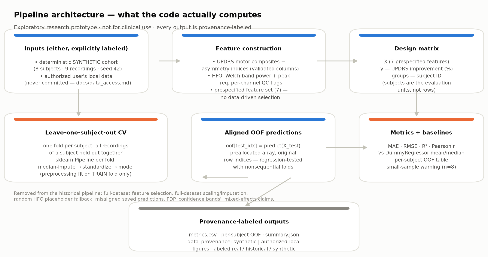

# CURVE-ICON-DBSO

**CURVE** — The Center for Undergraduate Research in Viterbi Engineering ·
**ICON** — Informatics and Computing in Neuroscience Lab, USC ·
**DBSO** — Deep Brain Stimulation Outcome (prediction)

An exploratory, subject-grouped machine-learning analysis asking whether
intraoperative ECoG high-frequency oscillations (HFOs) and clinical measures carry
any signal about Deep Brain Stimulation outcome — on a pilot cohort of **8 subjects
(9 recordings)**.

> ### note: exploratory research prototype — not for clinical use
> Retrospective, single-center, n = 8. No valid study performance estimate exists in
> this repository: the historical results were invalidated by a prediction-alignment
> bug plus data leakage, and the only runnable results here are on **synthetic**
> verification data. Nothing here supports clinical decision-making, counseling,
> patient selection, or DBS programming.

---

## executive summary

- **Question:** can HFO + clinical features relate to motor improvement (% UPDRS
  change) after DBS, measurable at pilot scale? *(Answer at this sample size: not
  reliably — and that is the honest result.)*
- **Data:** the historical pilot used restricted former-lab data (USC DABI via
  the ICON Lab) that was never distributed here and is **no longer used — it
  is prohibited in this independent personal project**; all runnable code
  paths are verified on deterministic synthetic data, and any future data
  must be legitimately public and compliance-verified
  ([docs/data_access.md](docs/data_access.md)).
- **Correction story:** the original pipeline reported R² = 0.713 (README) while its
  own figures showed −0.672. Root cause found: fold-order predictions saved against
  original-row-order subjects. This repository contains the corrected evaluation,
  tests that pin it, and the invalid figures archived as documentation.
- **Status:** research prototype; negative/feasibility results expected and preserved.
  Engineering through Phase 5 of [docs/mlops_extension_plan.md](docs/mlops_extension_plan.md)
  is complete and verified: the ephemeral public synthetic AWS environment was
  deployed, load-tested, failure-exercised, and **destroyed** (measured results and
  teardown evidence in [docs/deployment_report.md](docs/deployment_report.md);
  architecture in [docs/architecture.md](docs/architecture.md)).

## Research questions (two, kept strictly separate)

1. **DBS-outcome prediction (paused).** Do resting/task ECoG HFO features recorded
   from sensorimotor cortex, together with routine clinical measures, carry
   measurable association with the *magnitude of motor improvement after DBS* —
   and can any such association survive honest, subject-grouped validation at
   n = 8? This is the historical outcome question; it is **paused** because the
   clinical outcome table was unavailable at analysis time and could not be
   recovered. The corrected pipeline and its 7-feature prespecified schema are
   ready for it, but no outcome result exists or is claimed.
2. **Kinematic neural–motor analysis (active, prespecified).** Do resting-state
   HFO features and basic covariates relate to *concurrent motor performance*
   (finger-tapping rate from a sensor glove) during intraoperative recordings?
   This is an exploratory neural–motor relationship question — explicitly **not**
   DBS-outcome prediction, since glove kinematics measure motor state during the
   session, not treatment response. (See [docs/methodology.md](docs/methodology.md).)

Both questions use subjects (not rows) as evaluation units, fold-local
preprocessing, baselines, aligned out-of-fold predictions, and fixed
hyperparameters. Neither has produced a real-data result; the only runnable
verification is synthetic.

## Dataset and cohort

| Item | Value |
|---|---|
| Source | USC DABI (Data Archive for the BRAIN Initiative), via the ICON Lab — historical, restricted, **no longer used; see [docs/data_access.md](docs/data_access.md)** |
| Modalities | UPDRS assessments (pre/post) · intracranial ECoG + recording metadata · cortical thickness (MRI) · HFO features |
| Cohort | **8 unique subjects, 9 recordings** — one subject contributes 2 recordings (REST + MOVE); remaining subjects contribute 1 |
| Counts in results | Every result reports both subject and recording counts |
| Privacy | No participant data, subject identifiers, raw signals, or per-subject outputs are committed; `data/`, `outputs/`, `*.csv`, `*.mat` are gitignored |

The 8/9 structure comes from tracked historical artifacts and is marked unverified
against the source data.


## Pipeline architecture



System-level diagrams — local research flow, synthetic artifact flow,
CI/CD, the AWS runtime, and the privacy boundary — are maintained in
[docs/architecture.md](docs/architecture.md).

## Implemented feature extraction (complete list)

Per ECoG channel ([`src/curve_icon_dbso/hfo.py`](src/curve_icon_dbso/hfo.py)):

- 4th-order zero-phase Butterworth band-pass (default **80–500 Hz**), validated
  strictly below Nyquist;
- Welch PSD → **band power** and **peak frequency**;
- per-channel **QC status + failure reason** — failures are never zero-filled, and
  there is no random/placeholder fallback anywhere.

Per subject ([`src/curve_icon_dbso/features.py`](src/curve_icon_dbso/features.py)):

- mean of OK channels for the two HFO features;
- UPDRS-derived bradykinesia / rigidity / tremor composites per side and
  **asymmetry indices**; disease duration; age;
- a **prespecified set of 7 features** — fixed a priori, no data-driven selection.

**Not implemented, therefore not claimed:** phase-amplitude coupling, artifact
rejection, SNR, stability metrics, spatial-distribution summaries. (The historical
README's "18 neural biomarkers" and "108 features" were unsupported — artifacts show
32 engineered columns, 2 of them HFO-derived.)

## Validation design (corrected)

1. **Subjects are the evaluation units**: leave-one-subject-out CV — every fold
   holds out *all* recordings of one subject; no recording straddles train/test.
2. **Fold-local preprocessing**: median imputation + standardization inside an
   sklearn `Pipeline`, fit on each training fold only. No feature selection (the 7
   features are prespecified).
3. **Baselines**: `DummyRegressor` mean and median through the identical procedure.
   A model is not called useful unless it beats both.
4. **Aligned out-of-fold predictions**: preallocated array,
   `oof[test_idx] = pipe.predict(X_test)` — regression-tested with nonsequential
   fold indices (`tests/test_alignment.py`).
5. **Metrics**: MAE, RMSE, R², Pearson r + per-subject OOF predictions and errors.
6. **Uncertainty**: subject-cluster bootstrap confidence intervals for MAE/RMSE
   (2,000 resamples, fixed seed) and a subject-level label-permutation null
   (≥ 200 permutations through the complete CV workflow, conservative p-values) —
   descriptive at pilot n, never confirmatory.
7. **No tuning**: hyperparameters are fixed and documented; nothing is optimized
   against held-out subjects.

**Small-sample caveat (applies to everything below):** LOSO on 8 subjects yields
exactly 8 held-out predictions. R² and correlation are highly unstable at this size
(expected R² under the null is *negative*); a single subject can flip any ranking.

## Verified results

**No valid real-data performance estimate exists.** The historical numbers
(R² 0.713 / 0.845) were products of the misalignment + leakage defects and are
retracted; their figures are archived under
[`figures/archive/`](figures/archive/README.md) as documentation of the defect.

What *is* verifiable is the machinery, on synthetic data
(`figures/synthetic_oof_verification.png`; regenerate with the quick start below —
seeded, byte-identical across runs):

| Model (LOSO, synthetic cohort) | MAE | RMSE | R² | Pearson r |
|---|---|---|---|---|
| Mean baseline | 5.29 | 6.37 | −0.256 | — |
| Median baseline | 5.37 | 6.33 | −0.242 | — |
| Linear Regression | 3.42 | 5.34 | 0.116 | 0.813 |
| Random Forest | 4.37 | 4.92 | 0.249 | 0.556 |
| Gradient Boosting | 4.49 | 4.72 | 0.310 | 0.561 |

*Synthetic data with a planted linear signal — these numbers demonstrate that the
evaluation is correctly aligned and leakage-controlled; they say nothing about real
DBS outcomes.* All three models beat both baselines here **by construction** (the
generator plants a learnable signal); with 8 real subjects the honest expectation is
a null or uninterpretable result, and the corrected pipeline is designed to show
that rather than hide it.


## Why n = 8 cannot establish clinical utility

- Eight held-out predictions give confidence intervals so wide that no model
  comparison is meaningful; R² can be negative for a genuinely informative model.
- Selection effects from requiring complete multi-modal data are unquantified.
- REST vs MOVE, anesthesia, and medication state confounds are unmodeled.
- Any "top feature" ranking at this n is noise; the pipeline therefore refuses to
  rank features. See [docs/limitations.md](docs/limitations.md).

## Quick start (offline, no data required)

```bash
git clone https://github.com/oleeveeuh/CURVE-ICON-DBSO.git
cd CURVE-ICON-DBSO

# locked environment (uv; reproducible per uv.lock; `.python-version` pins
# Python 3.11 — the same interpreter CI matrix and the Dockerfile use).
# These four extras cover the entire offline test suite plus the demo and
# service (the fifth, `cloud`, is only needed for the Locust load test in
# docs/runbook.md §8c):
uv sync --locked --extra dev --extra api --extra tracking --extra analysis \
  && source .venv/bin/activate
# ...or plain pip, which still works:
# python3.11 -m venv .venv && source .venv/bin/activate && pip install -e ".[dev,api,tracking,analysis]"

# deterministic synthetic end-to-end run (~seconds; adds bootstrap CIs and a
# label-permutation null — raise --permutations to the protocol default of 200
# for evaluation-grade runs)
curve-icon-demo --output-dir outputs/synthetic_demo

# regenerate README figures
python scripts/make_figures.py
```

## Using an external (non-synthetic) dataset

No third-party dataset is in this repository. This independent project
uses only legitimately public data: before any use, a dataset must be
recorded and verified in the compliance register
([docs/data_access.md](docs/data_access.md)) — dataset name, canonical
URL, version/accession, access date, license or terms, permitted uses,
attribution requirements, and redistribution/training restrictions.
Restricted, private, identifiable, or former-lab data is prohibited; no
DABI/USC authorization path exists for this project. Once verified,
store the data locally and:

```bash
python scripts/run_hfo_extraction.py \
  --input-dir /your/local/path/all_subs_preprocessed_data \
  --output-csv /your/local/outputs/hfo_channels.csv \
  --aggregated-csv /your/local/outputs/hfo_subjects.csv \
  --band-low 80 --band-high 500 --fs-override 1200
```

Details and the compliance register: [docs/data_access.md](docs/data_access.md);
the gate itself is [docs/approvals.md](docs/approvals.md).

## Phase 2: synthetic inference service (research demonstration)

A strictly validated FastAPI service serves a **synthetic-trained**
demonstration model — an engineering artifact, not a clinical or
scientific result. Setup, training, endpoint contract, manifest
explanation, Docker instructions, and troubleshooting live in
[docs/api.md](docs/api.md).

```bash
uv sync --locked --extra dev --extra api              # locked environment (idempotent)
python scripts/train_synthetic_model.py               # deterministic synthetic artifact
```

Design points: one versioned 7-feature schema shared by training, the
API, and the manifest (`src/curve_icon_dbso/schema.py`); hash-verified
artifact loading that fails readiness loudly on any mismatch; batches of
1–256 rows with order-preserving predictions; payloads, predictions, and
feature values never logged; non-root single-worker container with a
readiness-gated health check; **no `/explain` endpoint** by approved
decision ([docs/decisions/ADR-002-explanation-endpoint.md](docs/decisions/ADR-002-explanation-endpoint.md)).
Measured (2026-11-15): container image 189.5 MB, containerized cold
start 0.85 s median, local dev-machine cold start 1.15 s median
([docs/deployment_report.md](docs/deployment_report.md) §2).

A reviewer can verify the service end to end in about a minute once the
artifact is trained. First locally (artifact dir defaults to
`./artifacts/synthetic-demo`), then in the container (built tag `local`,
mapped to host port 8001 so it cannot collide with the local server):

```bash
# 1) local service
uvicorn curve_icon_dbso.api.main:app --workers 1 --no-access-log &
sleep 3
curl -fsS http://127.0.0.1:8000/ready        # 200 once the artifact hash chain verifies
curl -fsS http://127.0.0.1:8000/model-info | python3 -m json.tool   # synthetic-only provenance visible
curl -fsS -X POST -H 'content-type: application/json' \
  --data @tests/fixtures/synthetic_predict_request.json \
  http://127.0.0.1:8000/predict              # schema-valid synthetic batch, 1–8 rows

# 2) container (image retrains the model internally during the build)
docker build --build-arg SOURCE_SHA=$(git rev-parse HEAD) \
    -t curve-icon-dbso-api:local .
docker run --rm -d -p 8001:8000 curve-icon-dbso-api:local
sleep 3
curl -fsS http://127.0.0.1:8001/ready
curl -fsS http://127.0.0.1:8001/model-info | python3 -m json.tool
curl -fsS -X POST -H 'content-type: application/json' \
  --data @tests/fixtures/synthetic_predict_request.json \
  http://127.0.0.1:8001/predict

# 3) stop both
docker stop $(docker ps -q --filter ancestor=curve-icon-dbso-api:local)
kill %1   # the backgrounded uvicorn
```

The full endpoint contract, error classes, manifest walkthrough, and
troubleshooting live in [docs/api.md](docs/api.md).

## Phases 3–5: CI/CD gates and the public synthetic AWS track (deployed, verified, destroyed)

Every pull request runs: locked install, Ruff, the offline suite with
coverage, secret + subject-identifier scanning, a real container build with
SBOM generation and an exceptions-aware HIGH/CRITICAL vulnerability gate
([docs/vulnerability-exceptions.yml](docs/vulnerability-exceptions.yml)),
the image-content privacy check, and Terraform format/validate/lint/security
scans — plus a read-only Terraform plan on same-repository PRs
([.github/workflows/ci.yml](.github/workflows/ci.yml)).

The deployment path ([.github/workflows/deploy.yml](.github/workflows/deploy.yml))
authenticates to AWS exclusively through GitHub OIDC (no long-lived keys):
it builds the image once by git SHA, pushes it to ECR, resolves the
immutable digest, and — only after approval in the protected GitHub
environment `aws-synthetic` — applies Terraform, waits for ECS stability,
and smoke-tests through the approved ingress. The environment itself is
Terraform-managed ([infra/](infra/)): CloudFront (default
`*.cloudfront.net` TLS) → ALB (locked to CloudFront) → ECS Fargate,
versioned private artifact bucket, budgets at $5/$20, scale-to-zero by
default. Decisions: [ADR-004](docs/decisions/ADR-004-public-ingress-and-tls.md),
[ADR-005](docs/decisions/ADR-005-terraform-organization.md).

**Deployment status (measured 2026-11-15, see
[docs/deployment_report.md](docs/deployment_report.md)):** this
environment was deployed once, verified end to end, put through the
Phase 5 exercises, and then **destroyed** — it is ephemeral by design
(destroy-between-milestones), and the teardown orphan check came back
empty. Account constraint observed and worked around: this project's
AWS account is a new-AWS-experience project account whose managed SCP
denies `iam:CreateOpenIDConnectProvider`, so the OIDC deploy path
cannot run here — deploys for this account are local (`enable_github_oidc
= false`); the workflows remain valid for standard accounts. Bootstrap,
apply, verify, rollback, scale-to-zero, destroy, alarm triage, load
test, and the orphan check are documented step by step in
[docs/runbook.md](docs/runbook.md), with safe/mutating/destructive
commands clearly separated.

### Phase 5 measured results (summary — full numbers in the deployment report)

| Area | Measured result |
|---|---|
| Load test (1→50 users over 5 min, 50 sustained 10 min; synthetic payloads only) | 34,177 requests, **0 failures**, **p95 110 ms** (median 88), max 350 ms, **zero restarts**, memory flat ≈ 24 % |
| Container | image **189.5 MB** (ECR-measured), cold start **0.85 s median** |
| Failure → rollback exercise | deliberately failing image unhealthy in ~40 s → `unhealthy-targets` alarm fired → deployment circuit breaker rolled back in ~70 s with **zero dropped requests**, then converged on the good digest (idempotent second plan: no changes) |
| Drift demonstration | clean synthetic sample max PSI **0.005** (no features flagged); shifted sample max PSI **12.6**, all 7 features cross the 0.2 *educational* threshold — explicitly **not** validated clinical drift monitoring |
| Observability | 4 alarms → SNS topic, 2 low-cardinality log metric filters, dashboard with model-version visibility; application logs verified metadata-only (no payload or feature values, enforced by tests) |
| Cost | ≈ $0.84/day while a task ran (task + ALB); ≈ $0.54/day scaled to zero; **≈ $0 now** after teardown |

Acceptance targets (p95 < 200 ms, error < 0.1 %, zero restarts, stable
memory) were all **met by measurement**, not asserted. Alarm→SNS delivery
plumbing was verified by forcing alarm states; human-visible **email**
delivery remained unconfirmed (one-time subscription click) for the life
of the environment — flagged honestly rather than claimed.

### Optional local Kubernetes rendering (Phase 7, local `kind` only)

The same synthetic service also runs on a single-node local kind cluster
with probes, a hardened security context, rolling updates, Helm rollback,
and an HPA — built to compare Kubernetes' primitives against the measured
ECS baseline, not to replace it. The candid conclusion (no measured
problem solved; automatic HPA scaling is the one primitive ECS's
`desired_count` demo lacked) and the reproducible setup/teardown live in
[docs/kubernetes.md](docs/kubernetes.md) + [deploy/](deploy/). No EKS or
any cloud Kubernetes resource exists.

## Tests

```bash
pytest             # offline suite; no private data needed (the project sets -q
                   # via pyproject addopts, so plain `pytest` prints the count)
ruff check src tests scripts
```

With `--extra cloud` installed, the two Locust load-test-profile tests run
as well; without it they skip with an explanatory message. The container
tests build and measure a real image wherever a Docker daemon exists —
one of them asserts a real timing budget (< 2 s cold start) and can
fail on a heavily loaded machine; the deployment record measured 0.85 s
median on an idle one ([docs/deployment_report.md](docs/deployment_report.md)).

Coverage includes: OOF alignment under nonsequential folds, subject-group
integrity, fold-local fitting, hand-calculated metrics, HFO detection on synthetic
signals, Nyquist violations, failure-vs-zero QC, malformed-input errors,
subject-cluster bootstrap (cluster integrity, determinism, hand-checked draws),
the label-permutation null (block permutation, p-value convention), experiment
lineage and provenance fingerprints, the optional XGBoost exercise, kinematic
extraction on synthetic fixtures, governance-documentation checks, and an
end-to-end determinism check. CI runs the suite on Python 3.11/3.12 from the
committed lock file ([.github/workflows/ci.yml](.github/workflows/ci.yml)).

## Repository structure

```
src/curve_icon_dbso/   package: config, synthetic cohort, features, HFO, kinematics,
                       evaluation, bootstrap, tracking, reporting, schema,
                       artifact, training, drift (PSI demonstration),
                       api/ (Phase 2 inference service)
scripts/               CLI entry points (demo, synthetic model training, HFO
                       extraction, kinematic evaluation, figure generation,
                       drift demonstration, security scan, vulnerability gate)
locust/                load-test profile (synthetic payloads only; OBS-003)
deploy/                optional local-kind Helm chart + cluster config (Phase 7)
tests/                 offline test suite (count printed by pytest)
infra/                 Terraform for the public synthetic AWS track (single root
                       module + one-time remote-state bootstrap; ADR-005)
configs/               example YAML configuration
docs/                  data access, methodology, limitations, approvals, API guide,
                       architecture (diagrams), deployment report (measured
                       results), runbook (deploy/verify/rollback/scale/destroy/
                       alarms/incident), decisions/, vulnerability exceptions
figures/               verified figures (+ archive/ of invalid historical figures)
legacy/                archived original scripts, known-buggy, superseded — do not run
```

## Responsible use

This code and its outputs are exploratory research artifacts. They must not be used
for patient care, counseling, cohort selection, or device programming, and must not
be presented as clinically validated. If you build on this work, preserve subject
-grouped evaluation, report baselines, label synthetic vs real results, and keep
participant data out of version control.

## Realistic future work

1. Identify a legitimately public dataset that fits the kinematic analysis,
   verify it through the compliance register
   ([docs/data_access.md](docs/data_access.md)), then run and publish the
   honest result (likely null) with per-subject OOF tables.
2. Grow the cohort (order 10² subjects) from public or newly consented
   sources before any model comparison; pre-specify the primary analysis.
   (New data collection or any institutional involvement re-triggers the
   review requirements — [docs/approvals.md](docs/approvals.md) item 5.)
3. Replace band-power summaries with validated, artifact-controlled HFO detection.
4. Only then consider uncertainty quantification and interpretation tooling.

## Data citation and license

- **Data:** the historical pilot data (USC DABI via the ICON Lab) is retired —
  prohibited in this project, not pending approval. Any future public dataset
  is recorded with its canonical URL, version/accession, access date,
  license or terms, permitted uses, attribution requirements, and
  redistribution/training restrictions in the compliance register
  ([docs/data_access.md](docs/data_access.md)). No dataset has been verified
  yet, so there is no dataset citation to publish.
- **License:** deliberately absent. A license decision has not been made; until
  one is, all rights are reserved by default and the repository is not licensed
  for reuse.

## Known limitations

Summarized in [docs/limitations.md](docs/limitations.md): n = 8 statistics,
unverified cohort counts, single-center selection effects, unmodeled state
confounds, band-power-only HFO features, and RNG determinism that is
version-dependent.
