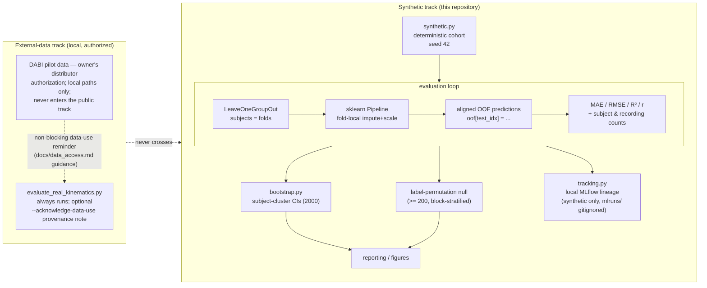
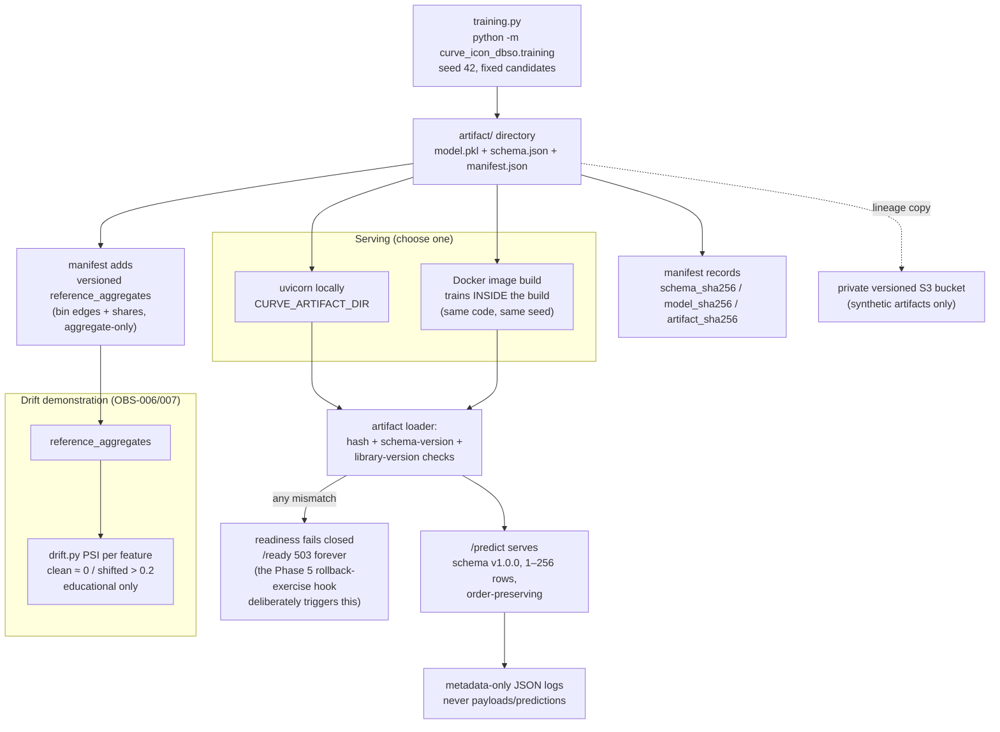
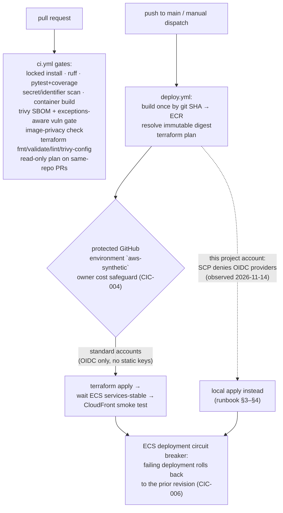
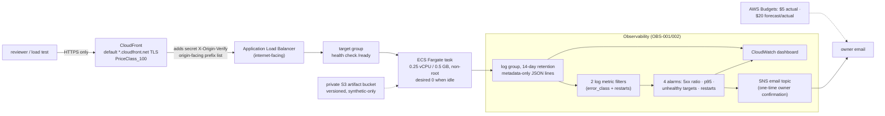
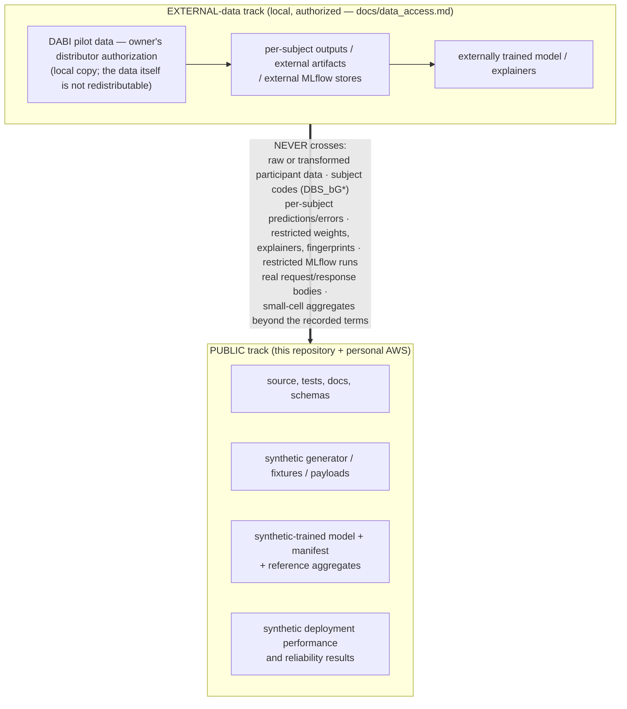

# Architecture

Current through the v1.0.1 corrective follow-on run (2026-11-18). Complements: [methodology.md](methodology.md)
(scientific design), [data_access.md](data_access.md) (privacy rules),
[runbook.md](runbook.md) (operations), [deployment_report.md](deployment_report.md)
(measured results from the one deployment), [decisions/](decisions/README.md)
(ADRs).

> **Research prototype — not for clinical use.** Everything shown here is
> deployment and serving measurements use synthetic data. Sanitized aggregate
> results from an exploratory, authorized local kinematic analysis are included,
> but they are not clinical results and do not evaluate treatment outcome.

## 1. Local research flow (offline, no data required)

The corrected evaluation loop is fully runnable on the deterministic synthetic
cohort. The external-data path was also run locally on an authorized 31-subject
kinematic cohort; only sanitized aggregate results are tracked here
([results_followon_real.md](results_followon_real.md)).

Two research questions are kept separate ([methodology.md](methodology.md)):

- **DBS-outcome prediction** (`updrs_improvement`; 7 prespecified
  features, n = 8) — **paused**: the clinical table was unavailable at
  analysis time and could not be recovered.
- **Kinematic neural–motor analysis** (`tap_rate_mean`; 5-feature reference
  plus a frozen follow-on matrix, n = 31) — **executed, negative, exploratory**:
  the v1.0.1 global-null verdict is definitive for the frozen matrix, not DBS
  outcome prediction.

## 2. Synthetic artifact flow (training → serving)

One versioned artifact is produced deterministically and verified
fail-closed everywhere it is loaded (MOD-003).

The image is the serving source of truth (`CURVE_ARTIFACT_DIR=/app/artifact`,
trained during the build); the S3 copy is a lineage archive. Both are
synthetic-only by policy.

## 2b. Follow-on study flow (frozen contract v1.0.1)

`protocol.py` (frozen machine-readable contract) → `neural_features`/`glove_phenotyping`/`signal_qc` (frozen feature extraction) → `subject_modeling` (nested subject-grouped REST/DELTA arms) → `move_modeling` + `dmd_representation` (window-level MOVE arm) → `scripts/run_followon_subject_modeling.py` and `scripts/run_followon_move_modeling.py` (local-only versioned runs). The original v1.0.0 run was corrected under v1.0.1 on identical manifest-verified inputs; the definitive aggregate verdict is in `docs/results_followon_real.md`.

## 3. CI/CD

On this project's account the deploy **workflow is intentionally
unusable** (`enable_github_oidc = false`); the workflows are kept for
standard accounts, and the same gates run locally via the runbook.

## 4. AWS runtime (the ephemeral `dev` environment)

Direct task access is impossible (the task security group admits only
the ALB security group — INF-005). The environment is destroyed between
milestones; teardown left **zero** project resources
([deployment_report.md](deployment_report.md) §8).

## 5. Privacy boundary

Enforcement in code, not prose alone: `.gitignore` blocks data file
types; `scripts/security_scan.py` (CI) rejects credential patterns,
subject-identifier patterns, and prohibited file types — with the single
sanctioned `legacy/` identifier archive exempted, as documented in
[data_access.md](data_access.md). Serving telemetry is metadata-only by
construction and by test.
